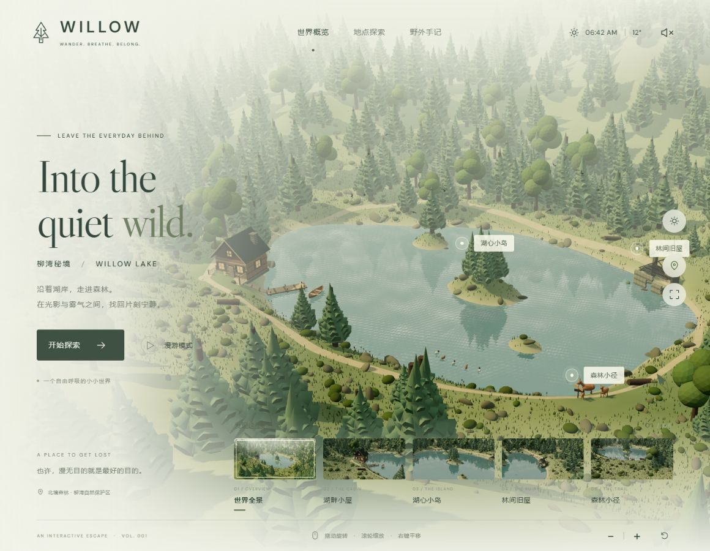

# WILLOW · 柳湾秘境

用 Three.js 构建的可交互湖畔森林场景。所有场景几何、地形、水波法线、雾气与环境音均由代码生成。运行时的脚本、字体及资源都已包含在此目录，无需联网加载。

- 在线预览：[https://uling19.github.io/willow-lake/](https://uling19.github.io/willow-lake/)
- GitHub 仓库：[https://github.com/ULing19/willow-lake](https://github.com/ULing19/willow-lake)
- GitHub Actions：[Pages 部署工作流](https://github.com/ULing19/willow-lake/actions/workflows/deploy-pages.yml)

这是一个和 [cinematic-rocket-launch](https://github.com/ULing19/cinematic-rocket-launch) 相同发布方式的 GitHub Pages 项目：推送到 `main` 后由 GitHub Actions 自动构建并部署。



## 创作来源

项目由用户最初的一句话需求生成，并在其基础上实现了可环绕探索的完整场景：

> 使用three.js构建包含湖泊、小屋、岛屿、废弃房屋、船只、小径、植被、野生动物和森林，采用电影感自然光照与雾气效果，支持环绕探索。

场景地形、建筑、树木、船只、动物、水面、雾气与环境音由 Three.js 和 Web Audio API 程序化生成；没有外部模型依赖。

## 运行

需要 Node.js 18 或更高版本。在此目录运行：

```shell
node serve.mjs
```

打开 http://127.0.0.1:4173 。Windows 也可以双击“启动场景.cmd”。停止服务时按 Ctrl+C。端口可通过 `PORT` 环境变量调整。

## 探索

- 鼠标左键拖动：围绕当前目标旋转；滚轮或右下角按钮缩放；右键拖动平移。
- 触摸屏：单指环绕；双指缩放和平移。
- 选择底部五个地点或画面中的标记，平滑切换到全景、小屋、湖心岛、旧屋和鹿群所在的小径。
- 右侧太阳按钮切换晨光与黄昏；定位按钮显示或隐藏地点标记；全屏按钮放大场景。
- 首页“漫游模式”自动环绕；拖动画面即可接管。右上角声音按钮开启或关闭生成的风声与鸟鸣，默认静音。
- 键盘方向键旋转，`+` / `-` 缩放，`0` 返回全景。Tab 可以访问所有操作按钮。
- 顶部“野外手记”打开场景故事，Esc 关闭。

## 场景内容

程序化起伏地形、湖泊与三个岛屿、1850 株实例化林木（小屏幕初次加载为 1050 株）、沿岸小径、木屋和前廊、石屋遗迹、连接岸边的木码头与系泊划艇，以及草丛、灌木、芦苇、石块、倒木、三只鹿、五只野鸭和十二只飞鸟。

水面使用实时平面反射与动态法线；自然光包含阴影、天空半球光、远景雾和近湖薄雾。木舟、野鸭、飞鸟、烟囱烟雾、漂浮微粒和鹿的头部具有独立动画。支持减少动态效果的系统偏好。

这是虚构的自然环境；地名、时间及温度用于营造场景氛围。

## 编辑与重新构建

- `src/world.js`：地形、林木、建筑、动物、水面与光照。
- `src/main.js`：观景点、相机转场、控件与环境音。
- `index.html` / `style.css`：页面与响应式样式。
- `app.js`：已打包的运行版本，可直接使用。

```shell
npm install
npm run build
npm start
```

依赖版本固定在 `package.json`。Three.js 使用 MIT 许可证；DM Sans 与 Libre Caslon Display 使用 SIL Open Font License，字体许可证位于 `assets/`。

## 许可

本项目未声明整体开源许可证。项目中独立依赖和字体的许可证分别保存在 `THREE-LICENSE.txt` 与 `assets/`。
